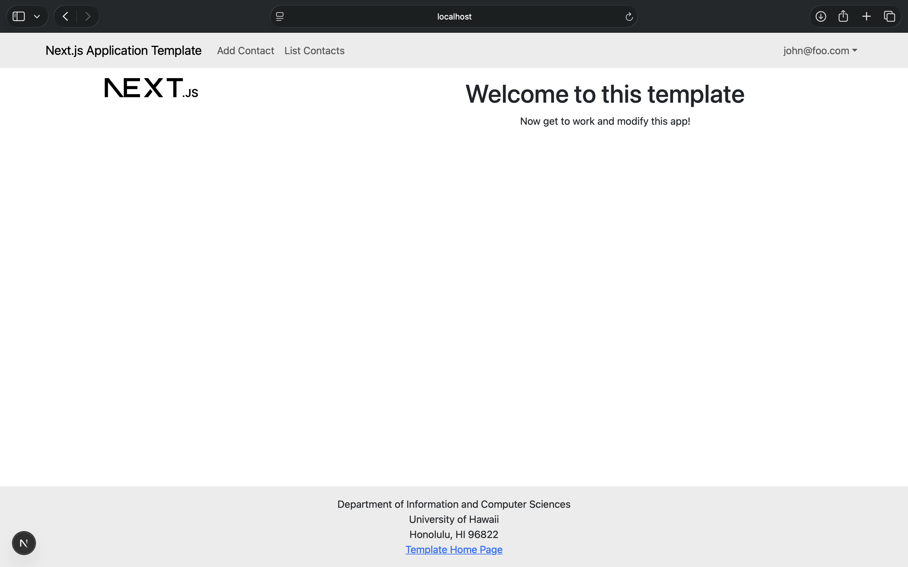

# Digits — Contact Management Application

Digits is a contact management application built with Next.js, React Bootstrap, Prisma, and PostgreSQL.

## Features

- User registration and login
- Add and edit contacts
- View a list of contacts
- Add notes to contacts
- Admin contact management

## Installation

1. Install Node.js and PostgreSQL.
2. Clone the repository:

   git clone https://github.com/linsammi/digits.git

3. Navigate into the project:

   cd digits

4. Install dependencies:

   npm install

5. Configure the environment variables and PostgreSQL database using the project configuration.
6. Run the Prisma database migrations:

   npx prisma migrate dev

7. Seed the database:

   npx prisma db seed

8. Start the application:

   npm run dev

9. Open http://localhost:3000.

## Application Pages

### Landing Page

The landing page introduces Digits and provides access to authentication.

### Sign Up and Sign In

Users can create an account and sign in to manage their contacts.

### List Contacts

Users can view their saved contacts and associated information.

### Add Contact

Users can create new contacts.

### Edit Contact

Users can update existing contact information.

### Notes

Users can add notes associated with contacts.

### Admin Page

Administrators can manage contact records.

## Repository

https://github.com/linsammi/digits
